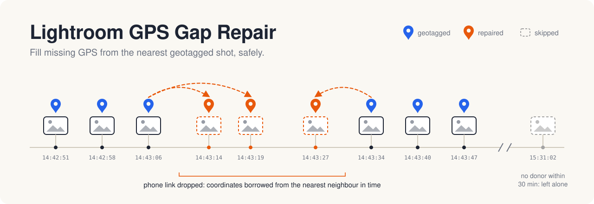

<picture>
  <source media="(prefers-color-scheme: dark)" srcset="docs/hero-dark.svg">
  
</picture>

# Lightroom GPS Gap Repair

[](pyproject.toml)
[](LICENSE)
[](https://exiftool.org)

Fills missing GPS coordinates in a **Lightroom Classic** library by copying latitude and
longitude from the **temporally nearest photograph that already has GPS**.

## Why

Cameras that take their location from a paired phone (Sony's *Location Information Link*,
and similar features from other brands) drop GPS whenever the link is not up yet. That
happens right after the camera wakes, or when the phone connection hiccups. You end up
with a handful of untagged frames, while the shots seconds either side are tagged
normally. This tool finds those gaps and fills them in from the nearest neighbour in time.
It changes nothing else.

## How it works

1. **Scan** the library for `.xmp` sidecars and read capture time and GPS via ExifTool.
2. **Classify** each sidecar: has GPS, has partial GPS, has no GPS, or is an unsynced stub.
3. **Freeze the donor set**: every sidecar that already has full GPS.
4. **Match** each GPS-less photo to the donor closest in capture time, within the gap limits.
5. **Back up and verify** (SHA-256) every file that will change, before touching any of them.
6. **Write** latitude/longitude into the sidecar, then **report** exactly what happened.

Dry run is the default. Nothing is written without `--apply` and a confirmation.

## Safety guarantees

1. **Only `.xmp` sidecars are ever written.** RAW files are opened read-only and never modified.
2. **Only sidecars with no GPS at all are touched.** Existing GPS is authoritative. A sidecar
   with partial GPS (latitude but no longitude) is skipped and never "completed".
3. **Every file that will change is backed up and SHA-256 verified first.** If any backup
   fails, the run aborts before a single sidecar is modified.
4. **Sidecars are never created.** ExifTool will happily create a file that does not exist,
   so the tool asserts the target exists immediately before each write.
5. **Repaired coordinates never propagate.** The donor set is frozen before any write, so a
   coordinate written during a run can never become a donor in that same run.
6. **Unsynced sidecars abort the run.** If Lightroom has not yet written its metadata to a
   sidecar, the tool refuses to proceed and tells you to run *Save Metadata to Files* first.

## Install

Requires Python ≥ 3.10 and [ExifTool](https://exiftool.org):

```bash
brew install exiftool          # macOS; see exiftool.org for other platforms
```

Then install the CLI with [uv](https://docs.astral.sh/uv/) or [pipx](https://pipx.pypa.io):

```bash
uv tool install git+https://github.com/schaefer-dev/lightroom-gps-gap-extrapolation
# or
pipx install git+https://github.com/schaefer-dev/lightroom-gps-gap-extrapolation
```

This puts `lightroom-gps-repair` on your `PATH`. It has no Python dependencies beyond the
standard library.

## Quick start

```bash
# 1. Dry run (the default): analyses and reports, changes nothing.
lightroom-gps-repair ~/Pictures/2026/Trip

# 2. Close Lightroom Classic, then apply. Backs up first and asks for confirmation.
lightroom-gps-repair ~/Pictures/2026/Trip --apply --backup-dir ~/Backups/LightroomGPS

# 3. In Lightroom: select the folder, then Metadata > Read Metadata from Files.

# Undo a run by restoring its backup.
lightroom-gps-repair restore ~/Backups/LightroomGPS/2026-09-19_193500
```

> [!IMPORTANT]
> **Close Lightroom Classic before applying.** Afterwards, use *Metadata > Read Metadata
> from Files* to pull the new coordinates into the catalog.

## Donor gap tiers

The *gap* is the time between a photo and its nearest already-geotagged neighbour.

| Gap | Action |
|---|---|
| ≤ `--max-gap` (default 600 s) | Applied silently |
| `--max-gap` … `--warn-gap` (default 1800 s) | Applied, flagged `WARN` for review |
| > `--warn-gap` | Skipped |

The WARN band exists because at ten-plus minutes the donor may be a genuinely different
location. That is worth a human glance rather than silent acceptance or silent discard.

## Options

| Flag | Meaning |
|---|---|
| `--apply` | Write changes (dry run is the default) |
| `--max-gap` / `--warn-gap` | Tier thresholds, in seconds |
| `--backup-dir DIR` | Backup location (default `~/LightroomGPSBackup`) |
| `--backup-mode` | `candidate-only` (default) or `all-xmp` |
| `--report-dir DIR` | Where reports are written (default: beside the backup, or a temp dir for dry runs) |
| `--require-raw` | Skip sidecars with no matching RAW file |
| `--same-folder-only` / `--same-camera-only` | Narrow the donor pool |
| `--copy-altitude` | Also copy GPS altitude (off by default) |
| `--allow-stubs` | Continue despite unsynced sidecars (they are still never written) |
| `--assume-tz` | Timezone for timestamps without an offset (`local` or `utc`) |
| `--yes` | Skip the confirmation prompt |

## Unsynced sidecars

If a folder was imported but never had *Metadata > Save Metadata to Files* run on it, its
sidecars are **stubs**: a rating and nothing else. They have no capture time, no camera
data and no develop settings.

The tool **aborts an apply run** when it finds any. The step it recommends afterwards
(*Read Metadata from Files*) would replace your Lightroom catalog metadata with those
near-empty files. Dry runs report stubs without aborting, so you can still survey the
library.

```text
ERROR: 514 XMP sidecar(s) are missing their Lightroom metadata.

  2026-09-16_Coast    377 of 460 sidecars
  2026-09-17_Coast    137 of 137 sidecars

Fix this first:
  1. Open Lightroom Classic.
  2. Select the affected folders.
  3. Metadata > Save Metadata to Files  (Cmd+S).
```

Detection is calibrated on real data: genuine Lightroom sidecars carry 78+ properties,
while stubs carry 6. Stubs are never written to and never act as donors, even with
`--allow-stubs`.

## Reports

Each run writes `report.csv`, `report.json` and `modified_files.txt`. Results use a fixed
vocabulary: `updated`, `updated_warn`, `skipped_max_gap`, `skipped_no_donor`,
`skipped_has_gps`, `skipped_partial`, `skipped_raw_gps`, `skipped_no_time`,
`skipped_stub_sidecar`, `failed`.

## Development

```bash
git clone https://github.com/schaefer-dev/lightroom-gps-gap-extrapolation
cd lightroom-gps-gap-extrapolation
uv venv && uv pip install -e ".[dev]"
.venv/bin/pytest -q
```

Fixtures in `tests/fixtures/real/` are real Lightroom Classic sidecars, anonymised
(coordinates shifted, creator replaced). Edge cases absent from real data, such as partial
GPS, malformed XML and missing timestamps, are generated synthetically. Tests marked
`exiftool` need the `exiftool` binary.

[`spec.md`](spec.md) is the full requirements specification.

## License

[MIT](LICENSE)
